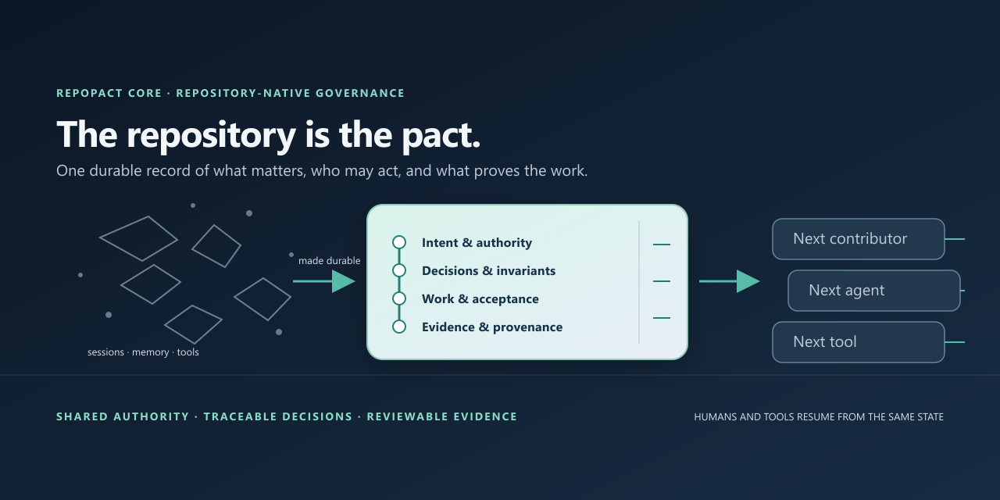

# RepoPact Core

**Repository-native governance for durable human–agent software engineering.**

AI-assisted development can move faster than a team can preserve the context that makes its changes responsible: what the project intends, who may change which paths, why a decision was made, which constraints are binding, what remains unfinished, and what evidence makes work complete.

RepoPact puts that load-bearing engineering state in versioned repository records. A new contributor can recover the represented project state from a clone instead of depending on a previous session, model, or private memory.

> **The repository is the pact.**
>
> People, agents, and tools coordinate through the same durable project records.



[Get started](#get-started) · [How it works](#how-the-pact-works) · [Documentation](#documentation) · [Research](#research)

RepoPact Core is the home of the `repopact` command-line package, canonical semantic engine, schemas, conformance suite, and reference governance records. It is open source under [Apache-2.0](LICENSE). The stable CLI package is published on [PyPI](https://pypi.org/project/repopact/); current release **3.1.3**. The separate [RepoPact Workbench](https://github.com/ForgeWireLabs/repopact-workbench) is a native interface that consumes Core; it is not part of the PyPI package.

## Why RepoPact exists

Source code usually survives a handoff. The governing state around that code often does not. A session ends, another contributor takes over, or work moves to another machine. They can see the files but may not know what was authorized, which constraints must hold, what choices are settled, what evidence supports a completion claim, or where the prior worker was uncertain.

RepoPact treats this as **governance discontinuity**: the loss or divergence of project authority and intent across people, tools, and sessions. Its response is to make that state inspectable and versioned beside the code.

| When project context is… | RepoPact makes it… |
| --- | --- |
| Held in a chat or one contributor’s memory | Recoverable from repository records |
| Reconstructed differently by each tool | Shared through typed, version-controlled records |
| Marked “done” without showing why | Verifiable through acceptance criteria and linked evidence |
| Implicit about authority and protected paths | Explicit through roles, scopes, invariants, and frozen surfaces |
| Inferred from an older repository | Honest about provenance and remaining uncertainty |
| Reflected in stale dashboards or indexes | Reconciled from authoritative source records |

The goal is not more ceremony. It is to make engineering work easier to resume, review, and verify across human and AI contributors.

## Get started

Install the stable Core CLI from PyPI:

```bash
python -m pip install repopact
```

Create a governed repository and record a unit of work:

```bash
repopact init --target ../your-repo
cd ../your-repo

repopact new work-item "Add retry policy"
repopact validate
repopact dashboard
```

For an existing project, preview what adoption would add before writing files:

```bash
repopact adopt --target ../existing-repo --dry-run
```

Review the plan, then run `repopact adopt --target ../existing-repo` to create its initial RepoPact records. Continue with the step-by-step [adoption tutorial](docs/adopt-repopact.md).

RepoPact does not require a particular coding agent, model provider, editor, CI vendor, or cloud account. The records are ordinary repository files and can be used by humans and tools that read them.

## How the pact works

```text
intent → scoped authority → work item → implementation → evidence → audit → history
```

RepoPact organizes the parts of engineering work that should survive a handoff:

- **Intent and decisions** record goals and durable choices, including rejected alternatives.
- **Roles and scopes** describe who can change which parts of a repository.
- **Work items** record ownership, affected scopes, dependencies, acceptance criteria, and lifecycle.
- **Invariants and frozen surfaces** make important guarantees and protected paths visible.
- **Evidence and provenance** connect completion claims to observations, and distinguish concrete facts from provisional or inferred records.
- **Audits and dashboards** expose drift and provide a useful view of the records.

In a governed repository, human-readable work-item notes explain intent while machine-readable JSON holds lifecycle and relationship state. Decisions preserve material choices; evidence records what actually ran or was observed. Core validates the records and their relationships, including dependencies and completion evidence.

### The repository is the authority

RepoPact gives each fact an authoritative home in the repository: governance records, work items, decisions, evidence, code, or explicitly governed configuration. Dashboards, the optional Repository Orientation Graph (ROG), generated specification sections, and Workbench screens are **derived views**. They help people navigate; they do not overrule the source records. If a view disagrees with its source, it is stale or wrong and should be reconciled.

ROG is a bounded, deterministic index for questions such as which work depends on a record, which tests relate to a package, or which governance applies. It is optional and does not need a model, embeddings, or a cloud service. [Learn about the graph](docs/repository-orientation-graph.md).

### Rules, authority, and evidence

A **principle** guides judgment; a **binding invariant** is a guarantee that must not be silently weakened. Where the invariant has a defined machine check, validation is the backstop. Where it does not, the record names an escalation path for human review. Ownership and frozen-surface rules make boundaries explicit, but do not themselves grant operating-system security.

Provenance keeps uncertainty visible during brownfield adoption. A record can be `concrete`, `provisional`, or `inferred`; reconstruction does not become fact merely because it has been written down. Acceptance criteria can require linked evidence before work is considered complete.

### Enforcement claims match their boundary

RepoPact distinguishes documented instructions, session-start checks, pre-action checks on covered operations, and an operating-system boundary that actually constrains a process. The portable reference baseline for the optional admission plane is `pre-action`: it checks a covered action before that action runs. It does **not** establish arbitrary-process filesystem confinement. A `sandbox/process-enforced` claim requires independent, platform-specific native proof. See [the enforcement guide](docs/guides/pre-execution-admission.md) and [decision 0060](decisions/0060-optional-sandbox-process-enforced-reference-confinement.md).

## Core architecture

Core is the semantic authority shared by command-line and graphical clients. The canonical validator and typed repository operations are implemented in Rust and distributed with the stable command-line package. The Python package provides the CLI and compatibility surfaces; the historical Python validator is an explicit comparator, not a second semantic authority.

The repository contains the Rust workspace, packaged schemas and templates, the 3.1.3 conformance corpus, documentation, and reference governance records. The [conformance contract](CONFORMANCE.md) defines what it means to claim compatibility with a specific RepoPact version. A conformance result is scoped to that version; it does not make claims about future versions.

### Core and Workbench are separate products

Core owns governance schemas and interpretation, validation, graph and analysis semantics, and typed mutation behavior. Workbench owns its interface, application orchestration, session handling, filesystem observation, and native desktop/mobile integration. It consumes one immutable Core revision and must not create a competing governance engine.

Install the CLI with `pip install repopact`. Workbench is a separate Tauri application with its own build and platform evidence; see [its repository](https://github.com/ForgeWireLabs/repopact-workbench) for current instructions. There are no Workbench installers in the PyPI package.

### Local-first verification

Repositories can define their own verification profiles and run them locally through Core. Hosted CI/CD is an optional adapter and is disabled by default in this repository’s verification policy. A passing local run is evidence for that run; it does not prove remote branch protection or a hosted admission boundary. Verification, building artifacts, and publication are separate operations.

## Research

RepoPact is both a usable tool and an ongoing software-engineering research project. The repository contains a [paper draft](research/paper.md), a [formal model](research/formal-model.md), experiment and benchmark protocols, a findings register, and [threats to validity](research/threats-to-validity.md). The research is intended to test the architecture, including where its assumptions fail; a protocol or benchmark harness is not itself a completed comparative result.

The machine-readable [conformance suite](CONFORMANCE.md) provides version-scoped compatibility cases. Research protocols and the proving-ground experiments are separate from that normative compatibility contract.

## Documentation

- [Adopt RepoPact](docs/adopt-repopact.md) — tutorial for new and existing repositories.
- [Documentation map](docs/README.md) — guidance for use, concepts, integration, and development.
- [Concepts](docs/concepts.md) — authority, lifecycle, provenance, evidence, and assurance boundaries.
- [Repository Orientation Graph](docs/repository-orientation-graph.md) — optional derived index and queries.
- [Specification](SPEC.md) and [conformance contract](CONFORMANCE.md) — normative model and version compatibility.
- [Contributing](CONTRIBUTING.md) — development and contribution guidance.
- [Security policy](SECURITY.md) — how to report a security concern.

RepoPact is not an AI agent, model provider, issue tracker, hosted CI service, or operating-system sandbox. It complements Git, test frameworks, coding tools, and external authorization systems by giving them a shared, durable governance layer.

## License

RepoPact Core is licensed under [Apache-2.0](LICENSE).
